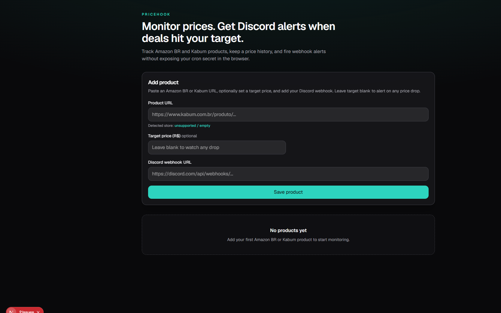
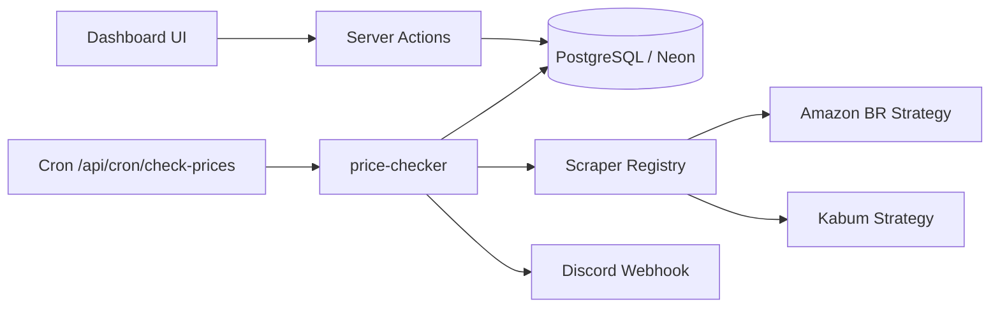

# PriceHook

Price and availability monitor for **Amazon BR** and **Kabum**, with Discord webhook alerts.

Scraping with a Strategy Pattern, resilient cron checks, price history, and a dark dashboard UI.

**Live Demo:** [price-hook.vercel.app](https://price-hook.vercel.app)



---

## Problem

Tracking deals manually is noisy: prices change often, stores block bots, and Discord spam gets ignored.

PriceHook solves that by:

- watching product URLs you care about
- storing a price history over time
- alerting only when a target is hit **or** the price drops
- failing per-product without killing the whole cron batch

---

## Features

- Add products with URL, optional target price, and Discord webhook
- Auto-detect store (`AMAZON_BR` / `KABUM`)
- Optional target: leave blank to alert on **any price drop**
- Cron route protected by `CRON_SECRET`
- Isolated scrape failures (`BLOCKED`, timeout, parse) saved in `lastError`
- Discord embed with previous price, new price, and discount %
- Dashboard actions: check now, pause/activate, delete, expand history

---

## Stack

| Layer | Tech |
|-------|------|
| App | Next.js 16 (App Router), TypeScript, Tailwind CSS |
| Data | Prisma 7 + PostgreSQL (Neon) |
| Scraping | Cheerio + Strategy Pattern |
| Alerts | Discord webhooks |
| Validation | Zod |
| Jobs | Protected API cron (`/api/cron/check-prices`) |
| Tests | Vitest |

---

## Architecture



Clean boundaries:

- `src/lib/scrapers` — extraction only
- `src/lib/alerts` — Discord + alert rules
- `src/lib/services` — orchestration
- `src/app` — UI + API routes

---

## Getting started

### 1) Install

```bash
npm install
```

### 2) Environment

```bash
cp .env.example .env
```

Fill at least:

```env
DATABASE_URL="postgresql://..."
CRON_SECRET="at-least-16-chars-secret"
```

### 3) Database

```bash
npx prisma migrate dev
```

### 4) Run

```bash
npm run dev
```

Open [http://localhost:3000](http://localhost:3000).

### Useful scripts

```bash
npm test                 # unit tests
npm run test:scraper -- "https://www.kabum.com.br/produto/..."
npm run db:studio        # browse data
```

---

## Cron + deploy (Vercel)

Price checks run on two schedules:

1. **Vercel Cron** (`vercel.json`) — once per day at 12:00 UTC (`0 12 * * *`), compatible with the free plan limit of 1 cron/day
2. **GitHub Actions** (`.github/workflows/cron.yml`) — every hour (`0 * * * *`) plus manual `workflow_dispatch`

```json
{
  "crons": [{ "path": "/api/cron/check-prices", "schedule": "0 12 * * *" }]
}
```

### Deploy steps

1. Deploy to Vercel
2. Set `DATABASE_URL` and `CRON_SECRET` in Vercel project env vars
3. In GitHub → **Settings → Secrets and variables → Actions**, add:
   - `APP_URL` — your deployed URL (e.g. `https://price-hook.vercel.app`)
   - `CRON_SECRET` — same value used on Vercel
4. Vercel Cron hits the route once daily; GitHub Actions keeps hourly checks

Manual local test:

```bash
curl -f -X POST http://localhost:3000/api/cron/check-prices \
  -H "Authorization: Bearer YOUR_CRON_SECRET"
```

---

## Alert rules

| Mode | When it alerts |
|------|----------------|
| No `targetPrice` | `currentPrice < lastPrice` |
| With `targetPrice` | `currentPrice <= targetPrice`, with anti-spam |

Anti-spam (target mode):

- first eligible alert always sends
- repeats after 24h, **or**
- sooner if the price drops even further

Unit tests live in `src/lib/alerts/alert-rules.test.ts`.

---

## Limitations (honest)

- **Amazon BR anti-bot (AWS WAF)** often blocks datacenter/server scrapes (`BLOCKED`). The strategy and error handling are in place; reliable Amazon scraping may need better fingerprinting/proxies later.
- **HTML scrapers are brittle.** Store DOM/JSON changes can break parsers; failures are isolated and visible in the UI via `lastError`.
- **No auth / multi-user yet.** This is a single-operator MVP.
- **No queue worker.** Cron processing is sequential and synchronous (good enough for small catalogs).
- **Discord depends on webhook validity.** Invalid/expired webhooks are recorded without losing price history.

These are intentional v1 trade-offs, not hidden bugs.

---

## Project structure

```text
src/
  app/                 # pages + cron API + server actions
  components/          # dashboard UI
  lib/
    scrapers/          # Amazon BR + Kabum strategies
    alerts/            # Discord + alert rules
    services/          # price-checker orchestration
    products/          # zod schemas + serializers
prisma/                # schema + migrations
docs/                  # demo assets
```

See also `PLAN.md` for the original staged implementation plan.

---

## License

MIT
